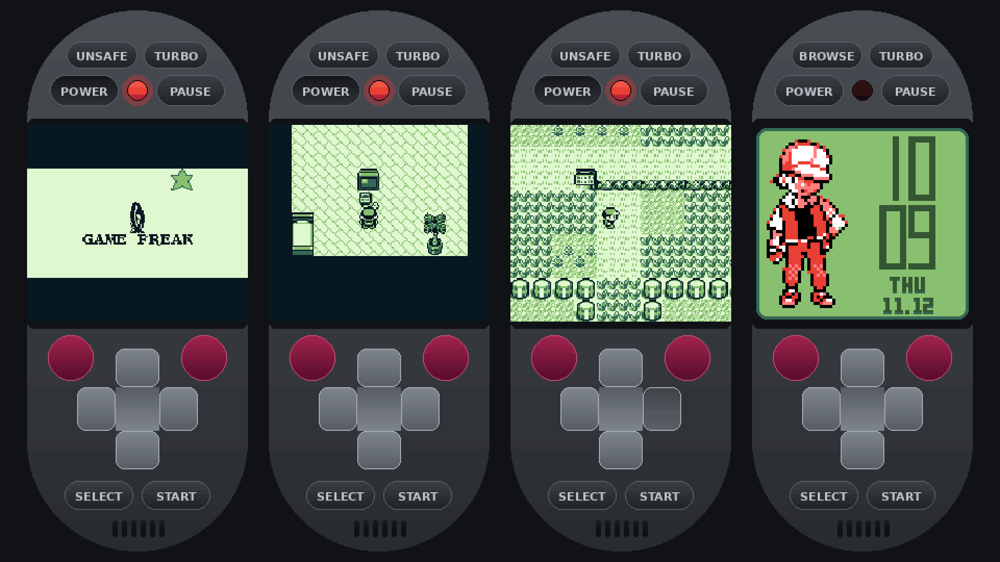
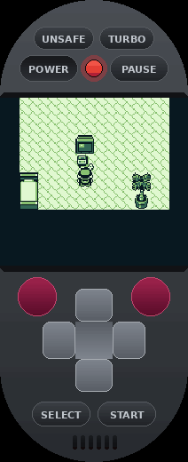
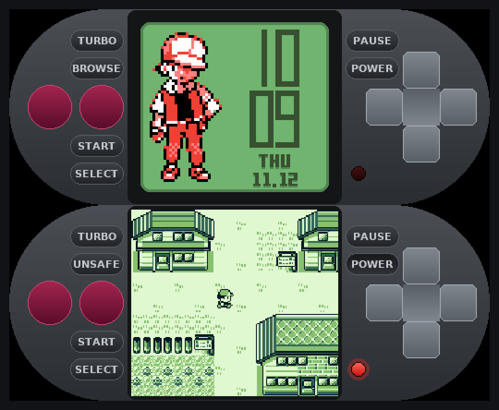
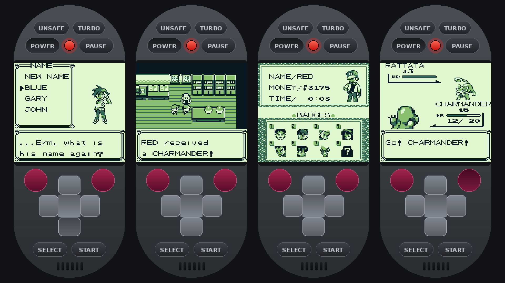
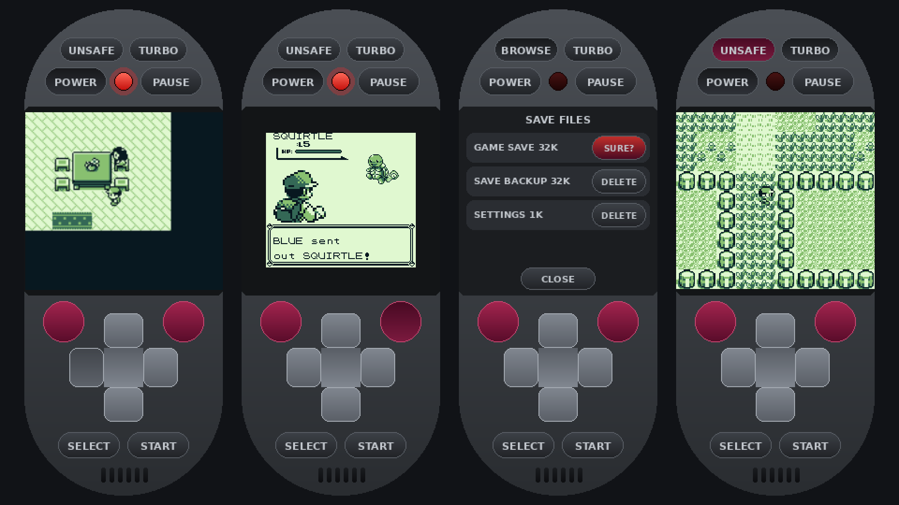
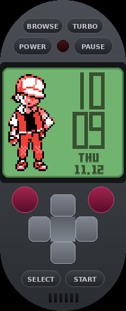
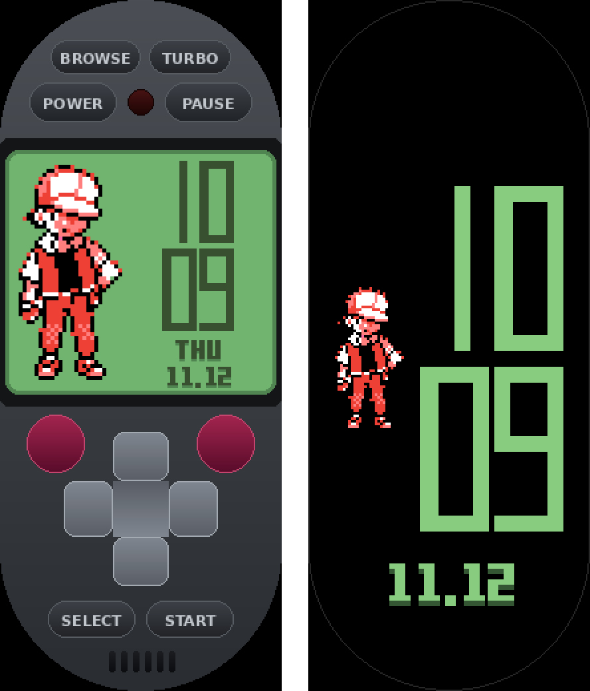
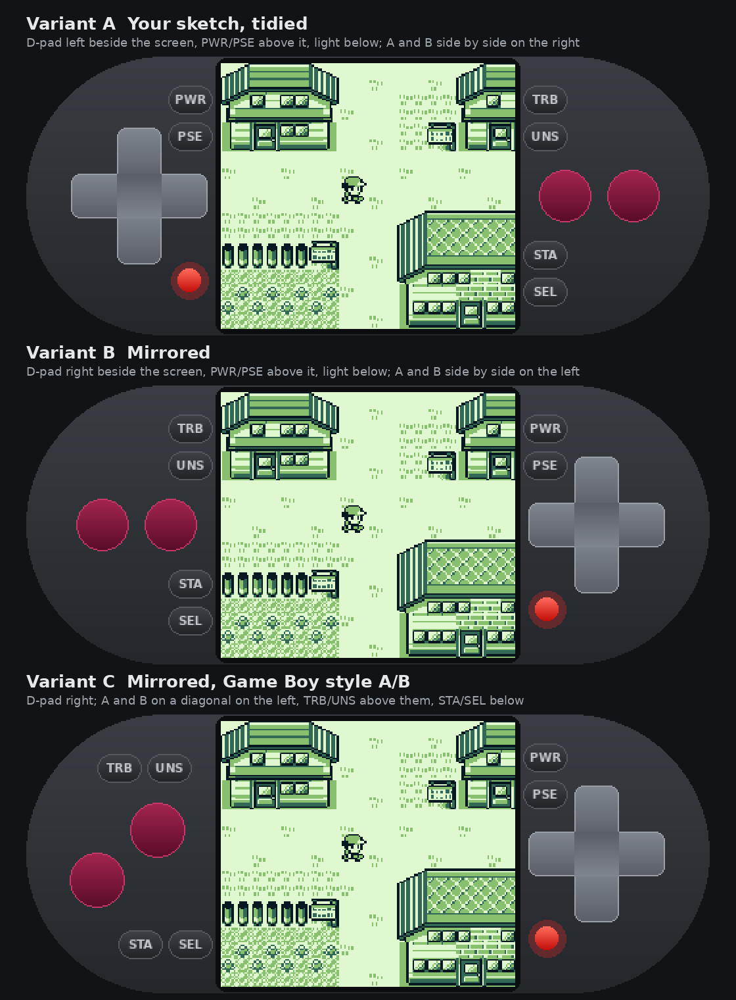
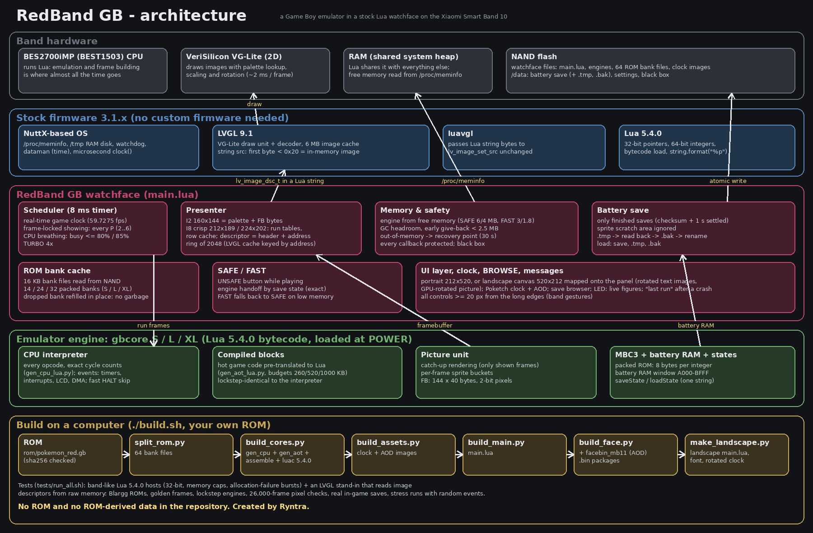
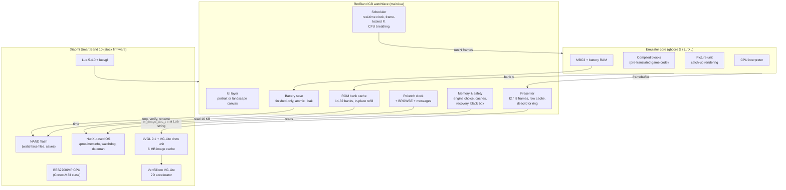

# RedBand GB

**A Game Boy emulator that plays Pokémon Red inside a normal watchface on the Xiaomi Smart Band 10.**
No custom firmware, no root, no hardware changes. It's a regular Lua watchface, not an RPK app.



| Portrait | Landscape (turned sideways) |
|---|---|
|  |  |

RedBand GB is a full Game Boy emulator written in Lua. It runs on the band's own watchface
engine: Lua 5.4 on top of the LVGL graphics library. Inside it you get:
- all Game Boy buttons on the touch screen;
- a Poketch-style clock when the game is off, and a Poketch always-on display;
- crash-safe saves, written only after you save in the game;
- SAFE and FAST (UNSAFE) performance modes;
- TURBO fast-forward;
- a save-file browser;
- a "black box" that records the figures from just before a crash.

As far as I know, it's the first project to run a full console emulator inside a stock watchface on
this band.

> **No ROM is included.** You need your own Pokémon Red cartridge dump to build the playable
> watchface. See [Building](#building).

**Status.** It plays well. In SAFE mode it has been played on a real Band 10 through Oak's lab
and the battles up to Viridian City without a crash. It isn't perfect:
- Busy scenes with many sprites run slower.
- It can still crash in rare cases. The band or watchface then simply restarts, and your last
  in-game save is protected.
- Only Pokémon Red is supported.

Improvements and ideas are very welcome (see [Contributing](#contributing)).

---

## Contents

- [Features](#features)
- [Gallery](#gallery)
- [How it works (short version)](#how-it-works-short-version)
- [Architecture](#architecture)
- [Building](#building)
- [Installing and playing](#installing-and-playing)
- [Performance and limits](#performance-and-limits)
- [Testing](#testing)
- [Repository layout](#repository-layout)
- [Regenerating the media](#regenerating-the-media)
- [Contributing](#contributing)
- [References and credits](#references-and-credits)
- [Legal](#legal)

Deeper documentation:

| Document | What's in it |
|---|---|
| [docs/ARCHITECTURE.md](docs/ARCHITECTURE.md) | Every part, every engine and every algorithm, with diagrams |
| [docs/ENGINEERING_REPORT.md](docs/ENGINEERING_REPORT.md) | The full engineering report: firmware analysis, design decisions, measurements, what failed and why |
| [docs/FIRMWARE_FINDINGS.md](docs/FIRMWARE_FINDINGS.md) | Firmware evidence table (addresses, functions, behaviour) |
| [docs/HISTORY.md](docs/HISTORY.md) | Version history, from 3 fps to full speed, and the lessons of each release |
| [docs/TESTING.md](docs/TESTING.md) | The test suite: hosts, LVGL stand-in, stress tests, how to run |
| [docs/VERIFICATION.md](docs/VERIFICATION.md) | Latest test results |
| [docs/LANDSCAPE.md](docs/LANDSCAPE.md) | The landscape face: layout, rotation, text rendering |
| [docs/USER_GUIDE.md](docs/USER_GUIDE.md) | Controls, modes, saves, troubleshooting |
| [docs/PUBLISHING.md](docs/PUBLISHING.md) | How to publish a watchface without the ROM |

---

## Features

- **Full Game Boy (DMG) emulation in Lua:**
  - CPU (Sharp LR35902);
  - picture unit with background, window and sprites;
  - timers, interrupts and joypad;
  - MBC3 memory bank controller with battery RAM;
  - save states.
- **Three engine sizes (S, L, XL).** The most-used game code is pre-translated into Lua ("compiled
  blocks") and shipped as Lua 5.4.0 bytecode. The engine is picked from the band's real free
  memory.
- **Display through the band's 2D graphics accelerator (VeriSilicon VG-Lite).** Every frame is an
  in-memory palette image handed to LVGL without touching the file system: about 2 ms of drawing
  per shown frame.
- **Three views** (long-press the screen):
  - crisp full width: 212×189, or 224×202 in landscape;
  - smooth GPU-scaled;
  - pixel-exact 1:1.
- **Real-time game clock.** The game runs at its real speed (59.7 fps) when the CPU allows. The
  screen shows every 2nd to 6th frame, always the same interval, so motion stays even.
- **SAFE and FAST modes:**
  - SAFE (default) leaves plenty of memory and CPU time for the band.
  - FAST (the UNSAFE button) trades that headroom for speed. It hands the running game to a bigger
    engine through a save state, so nothing is lost.
- **Crash-safe saves:**
  - written only after the game's own save has finished (checksum valid and stable for 1 s);
  - written to a temporary file, verified, then swapped in;
  - the previous save is kept as a backup;
  - battle sprites that Pokémon decompresses into its save memory are ignored.
- **Never-stop safety:**
  - the CPU busy share is capped, so the band's watchdog and services always get time;
  - memory is planned from real free memory, with caches given back early;
  - out-of-memory faults are recovered from, never fatal;
  - a recovery point is taken every 30 s.
- **Poketch clock and AOD.** Red on the left, hours over minutes, weekday and date. The time comes
  from the band's own time service.
- **BROWSE** to see and delete save files (two taps), **TURBO** (up to 4×) and the LED (tap: live
  figures; long-press: display path).
- **Landscape faces.** The same watchface turned sideways, with a bigger screen, for either hand
  orientation.
- **Controls kept away from the band's edges,** so side swipes don't trigger band gestures.

## Gallery

| | |
|---|---|
|  |  |
| [Second showcase (GIF)](docs/media/wide/RedBand_GB_showcase2_1920x1080.gif) · [MP4](docs/media/wide/RedBand_GB_showcase2_1920x1080.mp4) | [Third showcase: views, BROWSE, LED, UNSAFE + TURBO (GIF)](docs/media/wide/RedBand_GB_showcase3_1920x1080.gif) · [MP4](docs/media/wide/RedBand_GB_showcase3_1920x1080.mp4) |

| Portrait (clock) | Portrait + AOD | Landscape layout options |
|---|---|---|
|  |  |  |

All footage is real emulator output, recorded by the scripts in `tools/` and drawn exactly the
way the band draws it.

## How it works (short version)

**1. The band.** The Band 10 (firmware 3.1.33 analysed) runs watchfaces in **Lua 5.4.0** on top
of **LVGL 9.1** through the **luavgl** binding, on Xiaomi's NuttX-based system. The chip is a
Bestechnic **BES2700iMP** (internally BEST1503) with a **VeriSilicon VG-Lite** 2D graphics
accelerator.
- There is no per-watchface memory limit; Lua shares the system memory.
- `/proc/meminfo` tells the real free memory.
- LVGL keeps a separate 6 MB image cache.

**2. The display trick.** luavgl passes a Lua string's bytes straight to `lv_image_set_src`. If
the first byte is below 0x20, LVGL treats the source as an in-memory image descriptor. So each
shown frame is:
- one Lua string holding an LVGL indexed image (palette + pixels);
- a second, padded Lua string laid out as an `lv_image_dsc_t`, whose data pointer is the first
  string's byte address. That address is `string.format('%p')` plus the Lua string header size,
  measured at runtime.

LVGL's VG-Lite decoder copies the image into an aligned buffer, and the accelerator draws it with
its palette hardware. The Game Boy's 2-bit pixels map straight onto LVGL's I2 format. The crisp
view is I8 built from lookup tables and a content-keyed row cache. The last 2048 descriptors are
kept alive, because LVGL's cache is keyed by their address.

**3. The emulator.** A cycle-counted interpreter checked with Blargg's CPU test ROMs, with these
additions:
- **compiled blocks:** hot game code paths translated ahead of time into Lua, chosen by profiling
  real play;
- **catch-up rendering:** only frames that will be shown get drawn;
- **packed ROM banks:** 8 bytes per Lua integer, in a cache of 14–32 banks refilled in place.

**4. Time and pacing.**
- The game clock is the band's microsecond clock, independent of the screen.
- Only every P-th game frame is drawn (P = 2…6), chosen from how busy the band is.
- The UI thread is never kept busy more than 80% of the time (85% in FAST).

**5. Safety.**
- Memory is planned from real free memory.
- Saves are verified and atomic, and written only for finished in-game saves.
- Every callback is protected, out-of-memory errors are recovered from, and a 30-second recovery
  point is kept.
- A black box of figures survives a crash.

Full details: [docs/ARCHITECTURE.md](docs/ARCHITECTURE.md) and
[docs/ENGINEERING_REPORT.md](docs/ENGINEERING_REPORT.md).

## Architecture





More diagrams (frame pipeline, build pipeline, safety logic, engines) are in
[docs/ARCHITECTURE.md](docs/ARCHITECTURE.md).

## Building

Everything is built from source plus **your own ROM**:

1. Put your Pokémon Red (USA/Europe) ROM at `rom/pokemon_red.gb`. See
   [`rom/PLACE_ROM.GB_HERE.txt`](rom/PLACE_ROM.GB_HERE.txt). The build checks its SHA-256
   (`5ca7ba01…6b7b`), because the compiled blocks and the save logic are made for that exact
   ROM.
2. Run:

   ```sh
   ./build.sh
   ```

   **Requirements:**
   - Python 3 with Pillow;
   - a C compiler with 32-bit support (`gcc -m32`, e.g. `gcc-multilib`);
   - `git` and internet access the first time. `tests/build_hosts.sh` fetches the official
     Lua 5.4.0 sources to build the band-like Lua host that compiles the bytecode engines.

3. The watchfaces appear in `output/`:

   | File | What |
   |---|---|
   | `RedBand_GB_4_6_0.bin` / `_noAOD.bin` | Portrait, with / without the always-on display |
   | `RedBand_GB_4_6_0_Landscape_TopLeft.bin` / `_noAOD.bin` | Landscape, band's top end on your left |
   | `RedBand_GB_4_6_0_Landscape_TopRight.bin` / `_noAOD.bin` | Landscape, band's top end on your right |
   | `…_noROM….bin` | The same faces without ROM or engines, for publishing |

**Build steps** (what `build.sh` runs):

| Step | Tool | Output |
|---|---|---|
| Lua hosts | `tests/build_hosts.sh` | `tests/bandhost32` (Lua 5.4.0, 32-bit like the band), `tests/bandhost64` |
| ROM banks | `tools/split_rom.py` | `app/lua/gbank00.dat … gbank63.dat` (16 KB each) |
| Engines | `tools/build_cores.py` (→ `gen_cpu_lua.py`, `gen_aot_lua.py`, `assemble_lua.py`) | `gbcore.lua` (source), `gbcore_{s,l,xl}.luac` (stripped bytecode) |
| Clock & AOD images | `tools/build_assets.py` | `clk_*.bin` (LVGL I8), `assets/aod/*.png` |
| Watchface script | `tools/build_main.py` | `app/lua/main.lua` from `tools/main_template.lua` |
| Portrait package | `RedBandLuaWatchface/build_face.py` | `.bin` with and without AOD (AOD records by `tools/facebin_mb11.py`) |
| Landscape | `tools/make_landscape.py`, `tools/build_landscape_assets.py` | landscape `main.lua`, rotated font (`fontland.lua`) and clock images |

The build is reproducible: a fresh clone plus the ROM gives byte-identical engines and
watchfaces.

## Installing and playing

Install the `.bin` like any other custom Band 10 watchface, using your usual watchface installer
app. The landscape faces have their own watchface IDs, so they can be installed alongside the
portrait one. Saves are shared between them.

| Control | Does |
|---|---|
| POWER | Start / stop the game. With the game off, the Poketch clock shows. |
| PAUSE | Pause / continue. |
| TURBO | Fast-forward (up to 4×, every 8th frame shown, LED blinks fast). |
| BROWSE (game off) | Save files on the band. DELETE takes two taps; deleting the game save also deletes its backup. |
| UNSAFE (game on) | FAST mode on/off (the button looks pressed while FAST is on). |
| D-pad, A, B, START, SELECT | Game buttons |
| Long-press the screen | View: crisp → smooth → 1:1 |
| Tap the LED | Live figures: game fps, CPU busy %, Lua memory, free memory, engine, ROM banks, map |
| Long-press the LED | Display path memory ↔ files (only if the game screen ever stays black) |

**SAFE vs FAST.** Every POWER starts in SAFE, which is recommended for long sessions, battles and
saving. FAST uses the biggest engine from only 3 MB free memory, caches more and lets the game use
85% of the CPU. It is smoother, but a sudden memory or CPU demand from the band (a notification,
a sync) can crash it. It drops back to SAFE on its own when memory gets low.

**Saving.** Save in the game (START → SAVE). The file is written about 1 s after the game
finishes saving; nothing is ever saved on its own. After a crash, press POWER: the screen shows
`last run: …` with the figures from just before it.

More: [docs/USER_GUIDE.md](docs/USER_GUIDE.md).

## Performance and limits

**Measured on the band** (early 4.0.0 reading, S engine, crisp view):

| Measure | Value |
|---|---|
| Game speed | 55.7 fps, 93% of real time |
| Emulation | ≈ 14 ms per game frame |
| Building one crisp frame in Lua | ≈ 22 ms |
| LVGL / VG-Lite draw | ≈ 2.1 ms per shown frame |

Later builds use the L/XL engines (about 25% and 35% less emulation time) and cheaper frame
building. On screen that means roughly 10–30 shown frames per second, depending on scene, view
and mode.

**On the desktop** (Lua 5.4, same code): the XL engine runs about 0.16 ms per game frame in
battles, against 0.45 ms for the plain interpreter.

**What limits it:**
- **Busy scenes.** Oak's lab costs about 65% more emulation per frame than a house (more scripts
  and sprites), so busy scenes run slower.
- **Memory.** Every shown crisp frame is a new 41 KB Lua string, because Lua strings can't be
  changed, so the garbage collector always has work. The bigger, faster engines need several MB
  free.
- **The band's single-touch screen.** Two buttons can't be held at once. That's fine for Pokémon;
  it's why action games would need different controls.
- **Other games.** Only Pokémon Red is supported. The engine handles MBC3 only, the compiled
  blocks and the save check are Red-specific, and there is no sound.

## Testing

The test suite runs the **real watchface code** on desktop Lua hosts that behave like the band:
- Lua 5.4.0 with 32-bit pointers and 64-bit integers;
- freed memory poisoned, and optional hard memory caps;
- injected allocation failures.

Next to that sits an **LVGL stand-in** that reads image descriptors from raw memory the way the
band does, including its 6 MB address-keyed cache.

```sh
git clone --depth 1 https://github.com/retrio/gb-test-roms /tmp/gb-test-roms
sh tests/run_all.sh /tmp/gb-test-roms
```

What it covers:
- **Accuracy:** Blargg CPU and timing ROMs, golden frames, and lockstep of each compiled engine
  against the interpreter through battles.
- **The watchface:** a feature walkthrough, recovery, saves (unit, end-to-end with a real in-game
  save, crash points), CONTINUE from real saves, engine handoff between modes, and the layout.
- **Endurance:** 26,000-frame sessions with every shown frame checked pixel by pixel, memory
  caps down to 1.7 MB, and pacing simulations.
- **Stress:** 60,000–100,000-frame runs on a simulated band with random screen-off, pause, TURBO,
  view changes and power cycles, plus bursts of allocation failures.

Details: [docs/TESTING.md](docs/TESTING.md). Latest results:
[docs/VERIFICATION.md](docs/VERIFICATION.md).

## Repository layout

```
build.sh                    one-step build from your ROM
rom/PLACE_ROM.GB_HERE.txt   where your ROM goes (never committed)
RedBandLuaWatchface/        the portrait watchface project (app/lua, preview images, packer)
tools/                      generators: CPU tables, compiled blocks, engines, assets, main.lua,
                            landscape layer, preview renderers, GIF/showcase makers, profilers
tools/media/                extra media scripts (menu capture, landscape mock-ups, make_media.sh)
tests/                      band-like Lua hosts, LVGL stand-in, every test, run_all.sh
assets/                     Poketch glyphs, trainer sprite, AOD images
docs/                       documentation; docs/media holds all GIFs, videos and pictures
```

## Regenerating the media

Every GIF and picture in `docs/media` comes from the real emulator through scripts in this
repository. With your ROM in place and the engines built, see
[`tools/media/make_media.sh`](tools/media/make_media.sh):
- `tools/gif_capture.lua` records scripted play (`tools/gif_route.lua`, or
  `tests/battle_route.lua` for battles);
- `tools/make_gif.py` makes the pill GIFs;
- `tools/make_showcase_wide.py` / `make_showcase_wide3.py` make the 1920×1080 showcases;
- `tools/render_preview.py` / `render_landscape_preview.py` render previews from layout dumps;
- `tools/media/landscape_mockups/` draws the landscape design options.

## Contributing

This project is the best balance I found between the band's memory and gameplay speed. If you
can make it faster or safer on the band, please open an issue or a pull request. Ideas that
could help:
- cheaper crisp-frame building;
- profiling later game areas to compile more blocks;
- MBC1/MBC5 support for other games;
- control schemes for action games.

When reporting a crash, include the `last run` line shown after pressing POWER, and what was
happening in the game.

## References and credits

**Created by Ryntra.**

Projects, research and posts this work builds on or was informed by:

- **Mi Band 10 hardware:**
  - **[atc1441 / MiBand10-BES2700iMP-BEST1503-Hacking](https://github.com/atc1441/MiBand10-BES2700iMP-BEST1503-Hacking)**,
    Aaron Christophel's reverse-engineered SDK for the Band 10's BES2700iMP (BEST1503), with a
    Doom port: chip identification, memory map, display and touch.
  - **[Hackaday: Hacking The Mi Band 10 Smart Band And Its Bestechnic SoC](https://hackaday.com/2026/06/21/hacking-the-mi-band-10-smart-band-and-its-bestechnic-soc/)**
    (21 June 2026).
- **Watchface format and tools:**
  - **[AIR-pixel / miband11-watchface-maker](https://github.com/AIR-pixel/miband11-watchface-maker)**:
    the watchface container and AOD records. `tools/facebin_mb11.py` is vendored unchanged
    (MIT).
  - **[Nadeflore / watchface-js](https://github.com/Nadeflore/watchface-js)**: used to unpack the
    Mi Band 6 Poketch watchface the clock glyphs come from (not included).
  - **[m0tral / MiWatchLuaWatchfaces](https://github.com/m0tral/MiWatchLuaWatchfaces)**: Lua
    watchface samples. They showed the `dataman.subscribe` time and date subscriptions used by
    the clock.
  - **[m0tral / EasyFace](https://github.com/m0tral/EasyFace)** and
    **[m0tral / UnpackMiColorFace](https://github.com/m0tral/UnpackMiColorFace)**
    ([kindyear's .NET 8 port](https://github.com/kindyear/UnpackMiColorFace)): Xiaomi watchface
    editor and unpacker.
  - **[ooflet / Mi-Create](https://github.com/ooflet/Mi-Create)**
    ([docs](https://ooflet.github.io/docs/quickstart/intro/)): Xiaomi watchface editor and its
    documentation and discussions.
  - **[GZ-920 / MI-Band-WatchFace](https://github.com/GZ-920/MI-Band-WatchFace)**: which LVGL
    version each band model uses.
  - **[Mateusz Nowak: Designing watchfaces for Xiaomi Band 10](https://mateusznowak.dev/articles/designing-watchfaces-xiaomi-band-10/)**:
    Band 10 watchface design notes.
- **Software stack on the band:**
  - **[LVGL](https://github.com/lvgl/lvgl)** ([docs](https://docs.lvgl.io)): the graphics
    library, its VG-Lite draw unit and image decoder (v9.1 sources read to match the firmware).
  - **[XuNeo / luavgl](https://github.com/XuNeo/luavgl)**: the Lua binding for LVGL, whose
    string-source handling makes the in-memory frames possible.
  - **[Lua](https://www.lua.org)** ([lua/lua on GitHub](https://github.com/lua/lua)): 5.4.0
    sources for the band-like test host and bytecode; 5.4.0, 5.4.6, 5.4.7 and 5.4.8 checked for
    the string-address technique.
  - **[Apache NuttX](https://github.com/apache/nuttx)**: the RTOS family the band's system is
    built on (`/proc/meminfo`, watchdog driver).
- **Game Boy and Pokémon:**
  - **[Pan Docs](https://gbdev.io/pandocs/)**: the Game Boy technical reference.
  - **[retrio / gb-test-roms](https://github.com/retrio/gb-test-roms)**: Blargg's test ROMs,
    used by the test suite.
  - **[pret / pokered](https://github.com/pret/pokered)**: the Pokémon Red disassembly, for RAM
    addresses (map, position, battle and party state) and the save layout and checksum the save
    logic relies on.
  - **[doomhack / GBADoom](https://github.com/doomhack/GBADoom)**: the Doom port used in atc1441's
    Band 10 work, as an example of what the hardware can do with custom firmware.
- **Artwork:**
  - **"Poketch" Mi Band 6 watchface by zantfaul**: the Poketch digits and weekday glyphs used by
    the clock and AOD.
- **Where it's published:**
  - **[amazfitwatchfaces.com: RedBand GB](https://amazfitwatchfaces.com/mi-band/view/630)**.

The complete list of sources, with what each one was used for (including the exact LVGL, luavgl,
Lua and NuttX source files that were read), is in section 8 of
[docs/ENGINEERING_REPORT.md](docs/ENGINEERING_REPORT.md).

## Legal

RedBand GB is a non-commercial fan project. It is not affiliated with or endorsed by Nintendo,
Creatures, GAME FREAK, Xiaomi or Bestechnic.
- **Trademarks:** Pokémon and Game Boy are trademarks of their owners.
- **ROMs:** this repository contains no ROM and no data derived from one. Build only with a dump
  of a cartridge you own, and don't share watchfaces that contain the ROM.
- **Licence:** the code and documentation written for this project are under the MIT licence
  (see [LICENSE](LICENSE)). Third-party parts keep their own licences
  ([THIRD_PARTY.md](THIRD_PARTY.md)).
