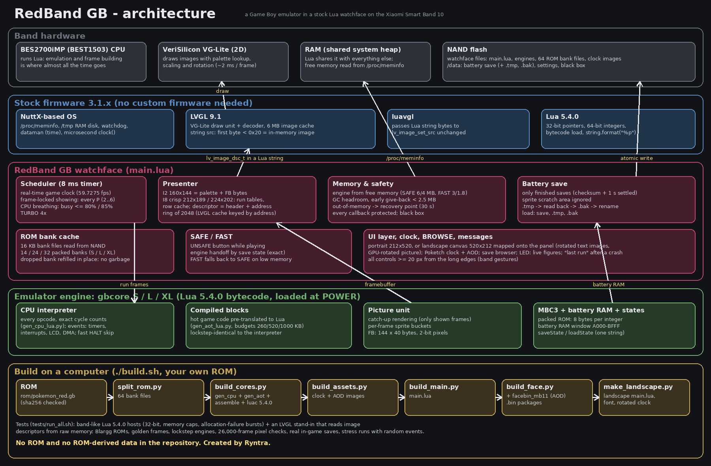
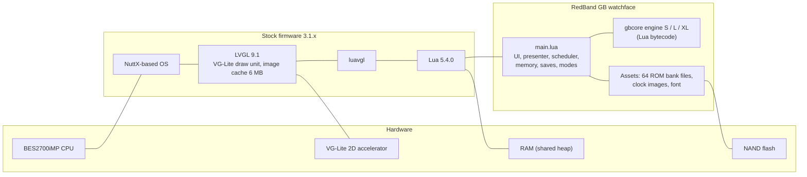
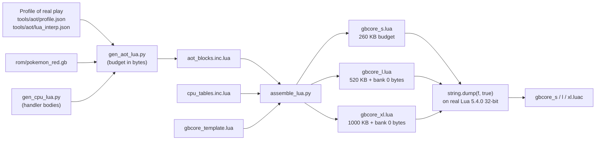
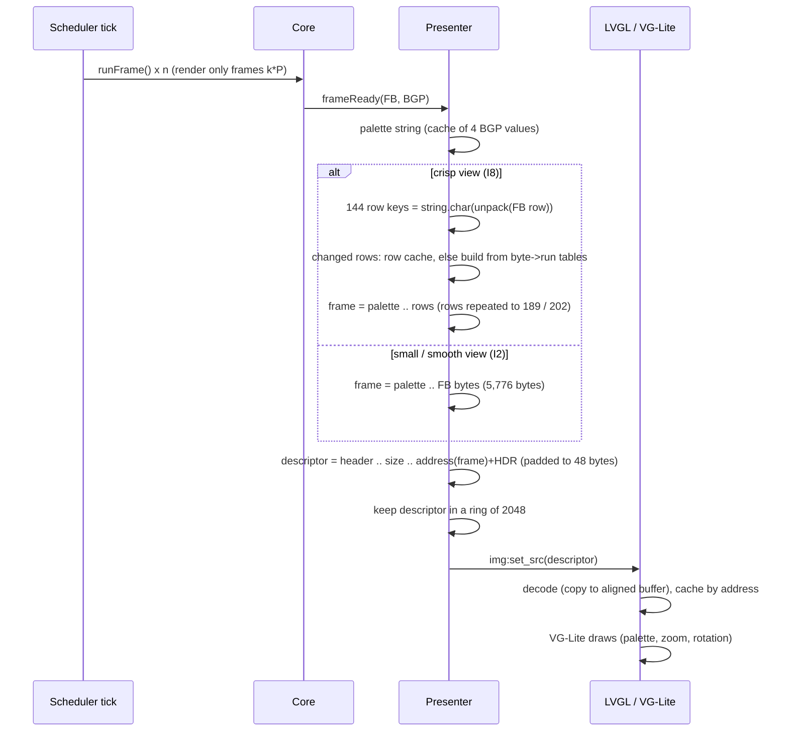
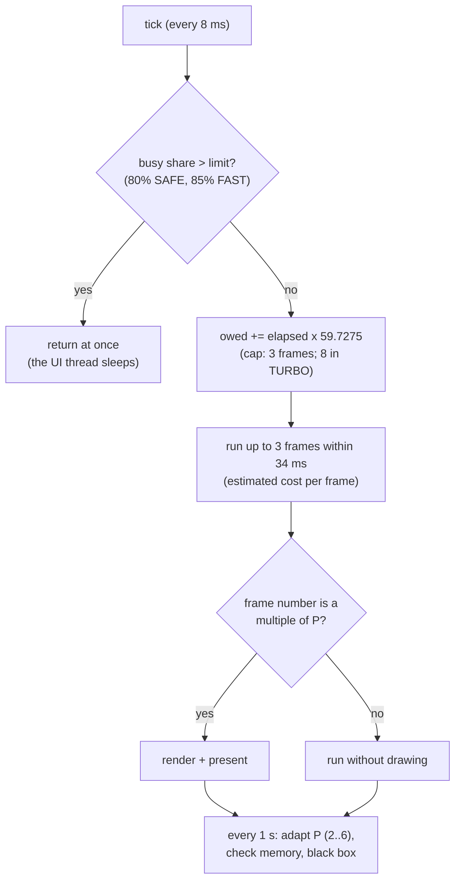
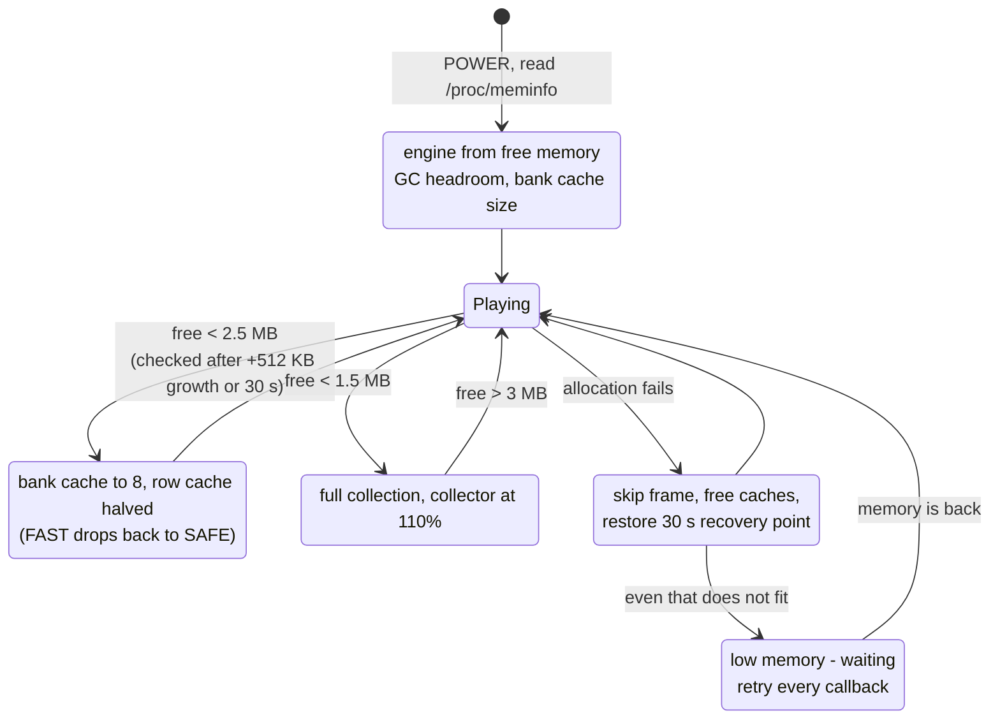
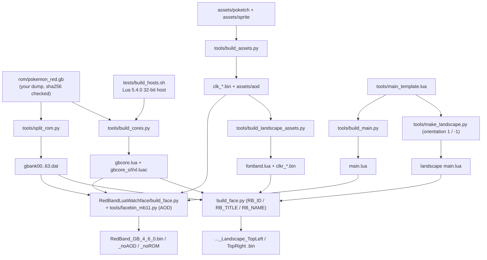
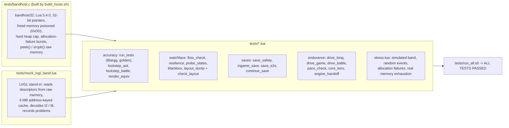

# RedBand GB architecture

This document describes every part of RedBand GB: what runs on the band, how a Game Boy frame
becomes pixels, how the emulator engines are built, and how memory, saves and crashes are
handled. File names refer to this repository.

- [1. Layers](#1-layers)
- [2. The band's software stack](#2-the-bands-software-stack)
- [3. The watchface script (main.lua)](#3-the-watchface-script-mainlua)
- [4. The emulator core](#4-the-emulator-core)
- [5. Compiled blocks and the three engines](#5-compiled-blocks-and-the-three-engines)
- [6. The display pipeline](#6-the-display-pipeline)
- [7. The scheduler: time, pacing and breathing room](#7-the-scheduler-time-pacing-and-breathing-room)
- [8. Memory planning and safety](#8-memory-planning-and-safety)
- [9. The battery save](#9-the-battery-save)
- [10. SAFE / FAST and the engine handoff](#10-safe--fast-and-the-engine-handoff)
- [11. Clock, AOD, browser, messages and black box](#11-clock-aod-browser-messages-and-black-box)
- [12. The landscape layer](#12-the-landscape-layer)
- [13. The build pipeline](#13-the-build-pipeline)
- [14. The test architecture](#14-the-test-architecture)

---

## 1. Layers

The watchface is three kinds of files inside a standard Band 10 watchface package:
- `main.lua`: the script the firmware runs.
- `gbcore*.luac` / `gbcore.lua`: the emulator engine, loaded at POWER.
- Assets: 64 ROM bank files of 16 KB, the Poketch clock images, and, for landscape, a rotated
  font.

## 2. The band's software stack

From the firmware analysis (3.1.33; details in [FIRMWARE_FINDINGS.md](FIRMWARE_FINDINGS.md)):

| Component | What matters for RedBand |
|---|---|
| **Lua 5.4.0** | Doubles for numbers, 64-bit integers, 32-bit pointers. The watchface state is created with `luaL_newstate`; no per-watchface memory limit was found, so Lua shares the system heap. `string.dump` / `load` of 5.4.0 bytecode works. |
| **luavgl** | Image `src` accepts a userdata or a string. A string is passed to `lv_image_set_src` byte for byte. Image properties: `src`, `zoom`, `angle`, `antialias`, `pivot`, offsets. No canvas widget. |
| **LVGL 9.1** | `lv_image_src_get_type`: a first byte of 0x20–0x7F means a file path, ≥ 0x80 a symbol, anything else an in-memory `lv_image_dsc_t`. Images are decoded into a 6 MB cache keyed by the source. |
| **VG-Lite draw unit** | The VeriSilicon VG-Lite 2D accelerator draws images, with palette lookup, scaling and rotation in hardware. The VG-Lite decoder copies indexed images into aligned buffers. There is no VG-Lite box-shadow support, so shadows are drawn by the CPU and the design avoids them. |
| **NuttX-based OS** | `/proc/meminfo` gives real free memory. `/tmp` is a RAM disk; the watchface and `/data` live on NAND. A hardware watchdog restarts the band if the system stops responding. `clock()` counts microseconds. |
| **dataman** | Time and date subscriptions (`timeHourHigh/Low`, `timeMinuteHigh/Low`, `dateMonth`, `dateDay`, `dateWeek`) feed the clock. `os.date` is the fallback. |

## 3. The watchface script (main.lua)

`tools/main_template.lua` is written to `app/lua/main.lua` by `tools/build_main.py`. Its
sections, in order:

| Section | Job |
|---|---|
| Settings | One small versioned file (`/data/redbandgb_cfg40.txt`): view, display path, probe state, engine cap. Failure states from an older build are reset when the version changes. |
| Look | Colours and helpers (`shape`, `raised`, `sunk`, `caption`). No shadows. |
| UI layout | Buttons, D-pad, A/B, LED, screen and bezel. Every control is at least 20 px from the band's long edges. |
| Presenter | Builds and hands frames to LVGL (section 6). |
| ROM banks | Bank-file reader and packed-bank cache (section 4). |
| Engines | Chooses and loads S / L / XL (section 5). |
| Battery save | Finished-only, atomic saves (section 9). |
| Memory safety | GC planning, give-back, out-of-memory handling (section 8). |
| Scheduler | The game loop on an 8 ms LVGL timer (section 7). |
| Modes | SAFE / FAST and the engine handoff (section 10). |
| POWER / recovery | Start and stop, recovery points, fault handling. |
| Clock, browser, messages | The Poketch clock, BROWSE and the message line (section 11). |
| Test hooks | `RBGB40`: internal state exposed for the test suite only. |

Every event handler and timer callback is wrapped in `pcall`, so no error can escape into the
firmware.

## 4. The emulator core

`tools/gbcore_template.lua` is a port of a JavaScript core that passes Blargg's `cpu_instrs` and
`instr_timing`. It emulates the original Game Boy (DMG).

**CPU.** A cycle-counted interpreter for all opcodes, generated by `tools/gen_cpu_lua.py`.
- **Execution:** each handler fetches operands from the packed ROM or RAM and adds its exact
  cycle cost.
- **Events:** timers, interrupts, LCD mode changes and DMA are scheduled as events; the CPU runs
  until the next event (`cyc >= nextEvt`).
- **HALT:** skipped quickly. When the CPU halts, the core jumps straight to the next event, so a
  game that waits for VBlank costs almost nothing. That's why Pokémon, which waits a lot, is
  relatively cheap.

**Memory model** (built for a small Lua heap):
- ROM banks are **packed**: 8 ROM bytes per 64-bit Lua integer, 2048 integers per 16 KB bank. A
  byte read is `(word >> shift) & 0xFF`.
- Bank 0 is packed too (`P0`). The L and XL engines also keep bank 0 as plain bytes (`P0B`) for
  faster reads.
- The switchable bank is a reference (`PX`) to a packed table supplied by the watchface's bank
  cache.
- VRAM, WRAM, OAM, IO and HRAM live in one Lua table `RAM` of 25,088 entries:
  `0x8000–0xDFFF → RAM[addr − 0x7FFF]` and `0xFE00–0xFFFF → RAM[addr − 40447]`.
- An earlier design with a 1 MB ROM string and hash-table RAM needed more than 3 MB of Lua heap
  and ran out of memory.

**Picture unit.**
- **Catch-up rendering:** lines are drawn only for frames that will be shown. Before any write
  that changes the picture (VRAM, OAM, LCDC, scroll, window, palettes, DMA), the pending lines
  are drawn first. The result is identical to drawing line by line; `tests/render_equiv.lua`
  proves it.
- **Sprites:** sorted into per-line buckets once per frame (`scanOam`), with 10-per-line and
  priority rules, so each line looks only at its own sprites.
- **Framebuffer:** `FB`, 144 rows × 40 bytes, 2-bit colour numbers (pixel 0 in bits 7–6). The
  palette (BGP) is applied later, by the image palette.

**MBC3 and battery RAM.**
- ROM bank switching swaps `PX`.
- Battery RAM has 4 banks of 8 KB, kept as strings. The enabled bank is copied into the
  `A000–BFFF` window of `RAM` and copied back when the game disables the RAM or switches bank.
- `sramDirty` is set on any change.

**Save states.** `saveState()` returns one string: CPU registers, timers, the picture unit state,
`RAM` and battery RAM. `loadState()` restores it. The same format works for all three engines,
which is what makes the live engine handoff possible.

## 5. Compiled blocks and the three engines

Interpreting every instruction is the main cost. `tools/gen_aot_lua.py` compiles the hottest
code paths of Pokémon Red **ahead of time** into straight-line Lua.

**How a block is made.**
- **Source:** a block starts at a profiled entry address and is built from the **same handler
  bodies** as the interpreter, with operands turned into constants. There is no fetch, no
  decoding and no call per instruction.
- **Exactness rules:**
  - after every instruction, `if cyc >= nextEvt` the block returns to the interpreter, so events
    and interrupts happen exactly where they would;
  - a taken conditional branch returns, and JP / JR / CALL / RET / RETI / RST end the block;
  - in switchable-bank code, a write that changes the mapped bank returns;
  - HALT, STOP and illegal opcodes are never compiled;
  - blocks are enabled only when the cartridge header matches this exact ROM.

**Engine sizes.**

| Engine | Compiled code budget | Extras | Emulation time vs S (walking) | Bytecode size |
|---|---|---|---|---|
| S | 260 KB | – | baseline | ≈ 349 KB |
| L | 520 KB | bank 0 as plain bytes | ≈ 25% less | ≈ 561 KB |
| XL | 1000 KB | bank 0 as plain bytes | ≈ 35% less | ≈ 986 KB |

**Bytecode.**
- Engines are shipped as stripped Lua 5.4.0 bytecode, made by a real Lua 5.4.0 with 32-bit
  pointers (`tests/bandhost32`). It loads about 10× faster and uses about 20% less memory than
  source.
- If the band refuses bytecode, the watchface falls back to the next engine, and finally to the
  plain source `gbcore.lua`.

**Verification.**
- Every engine is run in lockstep against the plain interpreter, comparing CPU registers and all
  RAM every 250 frames, through intro, house, lab and battles (`tests/lockstep_aot.lua`,
  `tests/lockstep_battle.lua`).
- Blargg ROMs and golden frames run on each engine.

**Profiles.** The compiled code was chosen by playing the beginning of the game. Shared routines
(text, walking, menus, sprites, the main loop) run everywhere, so later areas are mostly covered
too. Code that isn't compiled runs in the interpreter: correct, just slower.

## 6. The display pipeline

**Formats.**
- **I2 (small 1:1 and smooth views):** a 4-colour palette (16 bytes) followed by the core's
  framebuffer bytes unchanged. The Game Boy's 2-bit pixel layout is exactly LVGL's I2 layout.
- **I8 (crisp view):** 160×144 becomes 212×189 in portrait or 224×202 in landscape.
  - **Portrait:** each framebuffer byte (4 pixels) becomes a run of 5 or 6 index bytes from
    precomputed tables, so 10 bytes give 53 pixels (53/40). Rows are repeated 21/16.
  - **Landscape:** an exact 7/5 mapping. 5 bytes (20 pixels) give 28 pixels with runs of
    6, 6, 5, 6, 5, and rows are mapped by 144/202.

**Row cache.** Each of the 144 source rows is keyed by its own 40 bytes (a short, interned Lua
string). A built row is kept in a two-generation cache:
- **Generations:** 96 / 160 / 256 rows for S / L / XL; when the new generation is full, it
  becomes the old one.
- **Hit rate:** while walking, about 80% of rows are rows already seen, in the same place or
  scrolled.

**The address trick.**
- **Header size:** `HDR`, the offset from a Lua string object to its bytes, is measured once at
  runtime. A probe allocates strings of known lengths and reads the exact memory counter
  (`collectgarbage('count')`); six candidates must agree, and the result must equal 8 + 2 × the
  pointer size.
- **Address:** `string.format('%p', s)` plus `HDR` is the address of the bytes. This is exact on
  Lua 5.4.0, 5.4.6, 5.4.7 and 5.4.8, checked on 200 strings each.
- **Descriptor:** the descriptor string is padded to 48 bytes. Lua interns strings of 40 bytes or
  less, so two identical short descriptors would share one address.

**Why a ring of 2048.** LVGL caches decoded frames by **descriptor address**. If a descriptor
were freed and its address reused while its old decoded frame was still cached, LVGL would show
the old frame. The cache holds about 120–220 of our frames. Keeping 2048 descriptors alive makes
reuse impossible unless LVGL drew fewer than one in nine shown frames.

**Probe and fallback.**
- At the first POWER, the in-memory path is tried. It is confirmed after 20 shown frames and
  remembered (`memok`).
- If three sessions in a row end abruptly during their first frames on a band where it never
  worked, the watchface switches to the **file path**: small I2 frames written to `/tmp` (the RAM
  disk) under unique names.
- A display error during a session switches to files for that session only.

**Views and geometry** (portrait):

| View | Image | Placement |
|---|---|---|
| Crisp | I8 212×189 | at (0, 110) |
| Smooth | I2 160×144 | zoom 338/256 by the accelerator, filtered |
| 1:1 | I2 160×144 | centred, no zoom |

In landscape, the image is built upright and turned 90° by the accelerator around its centre,
with `antialias=false` for crisp and 1:1.

## 7. The scheduler: time, pacing and breathing room

The game loop is an LVGL timer with an 8 ms period (`TIMER_PERIOD`).

- **Real-time clock.** Frames owed are computed from the band's microsecond clock, not from timer
  callbacks. If the band is slow, the game catches up within a small backlog. If it's far behind,
  the backlog is dropped and the game runs a little slower; it doesn't jump.
- **Frame-locked showing.** Only game frames numbered k × P are drawn, so every shown frame is
  exactly P game frames after the one before. P (2…6) rises when frames are missed and falls
  after 3 clean seconds with spare time.
- **TURBO.** 4× speed with a larger budget, showing every 8th frame.
- **Breathing room.** The busy share of the UI thread (our callbacks plus estimated LVGL drawing)
  is tracked over about 0.25 s, weighted by time. Above the limit, a callback returns without
  running frames, so the band's own services and its watchdog always get CPU time. Calm scenes
  never reach the limit; the heaviest scenes run a little slower instead.
- **Idle work.** Callbacks with nothing to do run a small garbage-collection step.

## 8. Memory planning and safety

**Engine choice** (free memory at POWER):

| Mode | XL engine | L engine | Otherwise |
|---|---|---|---|
| SAFE | ≥ 6 MB free | ≥ 4 MB | S |
| FAST | ≥ 3 MB | ≥ 1.8 MB | S |

**Collector.** The heap may grow beyond its live data by at most
min(free − reserve, cap, live), where the reserve is 4 MB in SAFE and 3 MB in FAST, and the cap
is 1.5 MB in SAFE and 2.5 MB in FAST. That figure sets the incremental collector's pause.

**ROM bank cache.**
- **Size:** 14 / 24 / 32 banks for S / L / XL, never planned into the last 3 MB free (2 MB in
  FAST).
- **Refill in place:** a dropped bank's table is refilled with the new bank, 8 words per
  `string.unpack`, with no temporary tables, so a bank load creates no garbage. Battles use about
  35 different banks; with 12 slots they caused about 700 reloads in 8 battles, against 7 with 32
  slots.
- **Load failures:** a failed load empties the cache and retries.

**Reactive safety.**
- An allocation that fails inside a frame frees caches and returns to the last recovery point. A
  recovery point is a save state taken every 30 s, between frames.
- Memory faults never stop the game. Other faults stop it cleanly after 3 within a minute.

**History.** A strict memory *budget* that showed fewer frames under pressure (4.2.0) made play
slow. It was replaced by this reactive design, which never limits frames in advance.

## 9. The battery save

Pokémon writes its save over several frames, with its checksum last. It also uses battery RAM
bank 0 as scratch space for decompressing battle and menu sprites.

- **Only finished saves are written.** The Pokémon checksum (complement of the 8-bit sum of
  `0x2598–0x3522`, stored at `0x3523`) must be valid, and the battery RAM must be unchanged for
  1 s.
- **Scratch space is ignored.** Bytes `0x000–0x597` (the sprite buffers) don't count when
  deciding whether there is anything new to write, so battles never trigger a file write.
- **Atomic and verified.**
  1. Write `name.tmp`.
  2. Read it back and compare.
  3. Rename the old good save to `name.bak`.
  4. Rename `.tmp` into place.

  A crash at any step leaves a good file.
- **Loading** takes the first file with a valid checksum: the save, then `.tmp`, then `.bak`.
- **BROWSE** lists all three. Deleting the game save deletes its backup and temp copy too.

Old builds wrote the file in the middle of the game's own save routine, and with `wb`, which
erases the old file first. That is how "The file data is destroyed!" happened.
`tests/save_e2e.lua` reproduces both the problem and the fix with a real in-game save.

## 10. SAFE / FAST and the engine handoff

- **SAFE** is the default at every POWER: 4.5.1's memory planning and an 80% busy limit.
- **FAST** (the UNSAFE button while playing) uses 4.5.0's planning: XL from 3 MB, more banks, a
  roomier collector, and an 85% busy limit.
- **Handoff.** If the wanted engine size differs, the watchface:
  1. writes any finished in-game save;
  2. takes a save state;
  3. loads the other engine module and creates an instance on the same host;
  4. loads the state into it.

  The old engine stays referenced until the new one works, so a failed switch changes nothing.
  `tests/engine_handoff.lua` shows S → XL → S gives a game identical (CPU and all RAM) to one that
  never switched.
- **Automatic fallback.** FAST drops back to SAFE by itself when free memory falls below 2.5 MB
  or after any out-of-memory rescue.

## 11. Clock, AOD, browser, messages and black box

**Poketch clock** (game off).
- Built from LVGL I8 images made by `tools/build_assets.py` from the Poketch glyphs: digits
  26×62 and 10×16, weekdays 34×16, and the trainer at 3×.
- Time comes from `dataman` subscriptions, with an `os.date` fallback.

**AOD.**
- **Records:** static AOD records written into the package by `tools/facebin_mb11.py`, based on
  AIR-pixel's packer: digit widgets on the firmware's time sources (hour 0811, minute 1011,
  month 1012, day 1812) and the trainer image, in light Poketch green on black. Lua does not run
  in AOD.
- **Fallback:** the `_noAOD` package uses the main-screen container layout already proven on the
  band.

**BROWSE.**
- Lists the game save, its backup and temp copies, and the settings file, with sizes.
- DELETE takes two taps ("SURE?"). While the game runs, the same button is UNSAFE.

**Messages.** One line (two in landscape) over the top of the screen for mode changes, recovery,
"last run" and the LED figures. Landscape draws them on a dark strip.

**Black box.**
- Every 10 s of play, one line is written to `/data/redbandgb_last.txt`: game fps, busy share,
  Lua heap, free memory, engine and mode, bank cache and the game map number.
- If a session ends without POWER off, the next POWER shows that line for 8 s.
- A tap on the LED shows the live figures.

## 12. The landscape layer

`tools/make_landscape.py` derives the landscape `main.lua` from the same template. Only the
drawing layer changes:

| Part | How |
|---|---|
| Logical canvas | Every object is placed on a 520×212 canvas and mapped onto the 212×520 panel by `L()`. Orientation 1 (band's top end on the left): x = H − Y − h, y = X. Orientation −1: x = Y, y = W − X − w. |
| Gradients | Run sideways (`bg_grad_dir` horizontal), with colours swapped as the orientation needs. |
| Text | luavgl can't rotate labels. `tools/build_landscape_assets.py` renders DejaVu Sans Bold 11 into rotated glyphs (16 px line, 2-bit alpha, I2), and a line of text is just its glyphs' row strings joined. Text images are written once per text and colour to `/tmp`; later messages are capped at 24 files. |
| Game picture | Built upright as I8 224×202 (exact 7/5) and turned 90° by the accelerator (`angle` 900 or 2700, `antialias` off for crisp and 1:1). |
| Clock | Rotated copies of the clock images (`clkr_*.bin`). |
| Messages | A dark strip with white text, readable over any scene. |

Details and layout: [LANDSCAPE.md](LANDSCAPE.md).

## 13. The build pipeline

`./build.sh` runs all of this. The package keeps `main.lua` as the last file (the layout proven
on the band), and the packer unpacks and checks every package it writes.

## 14. The test architecture

See [TESTING.md](TESTING.md) for what each test proves and how to run it.
