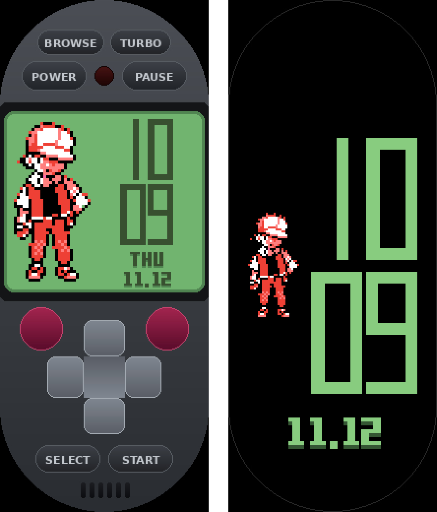

# RedBand GB 4.6.0 — Engineering Report

A Game Boy emulator running Pokémon Red as a Lua watchface on the Xiaomi Smart Band 10. This
report covers what the band's firmware revealed and the architecture built on those findings.
It also covers what each change did to speed and stability, how everything was verified, and
every source used, so a future project knows where to look.

---

## 1. Starting point and the problem (3.2.0)

The emulator core already worked. It is a Lua Game Boy core with compiled blocks, exact
shortcuts and catch-up rendering, and it passes Blargg tests and golden frames. On the band,
though, the game ran at about 3–4 shown frames per second and felt slow and jittery.

| Cause in 3.2.0 | Effect |
|---|---|
| Every shown frame was converted to RGB565 in Lua (about 80 KB of strings), written as up to 9 strip files to `/tmp`, then read back by LVGL. | Two file-system round trips and heavy Lua string work per frame. |
| Game frames ran only inside a 25 ms LVGL timer, at most 2 per callback. | When a screen refresh took about 150 ms, the game itself ran at about 20% speed. |
| Pacing used `os.time()`, which only counts whole seconds, and each callback ran 1 or 2 frames. | Uneven motion (the jitter). |
| Shadows on every button. | Drawn by the CPU on this firmware (see 2.4). |

## 2. Firmware analysis (Band 10 firmware 3.1.33, `miwear_watch_o66cn`)

**Method.** Firmware analysis covered `vela_ap.bin`, the main ARM image, using `strings` plus
Thumb-2 disassembly with capstone. Two address windows map onto the file: data at 0x2C0A0000 and
code at 0x0C0A0000 (file offset = address − base). The bases were fixed by finding the luavgl
method table: it sits at file offset 0x68A18C and points at the string "set_src" at 0x2C7296A8.
The firmware ZIP also contains `watchface.bin`, `app.bin` and `system.bin`. These are romfs
images, and they were parsed to survey Xiaomi's own image formats.

### 2.1 Platform

| Finding | Evidence | Consequence |
|---|---|---|
| Xiaomi Smart Band 10 on a BES2700iMP chip (Cortex-M33) | "Xiaomi Smart Band 10", `o66cn`; atc1441 research | No double-precision floating-point hardware, so floats are kept out of the hot loops. |
| Lua **5.4.0**: doubles plus 64-bit integers | "Lua 5.4.0 Copyright…", `%.14g`, `%lld` | `string.format('%p')` is available. Bytecode must come from exactly 5.4.0. |
| Watchface Lua state created with `luaL_newstate` | `bl 0xC166678` next to "no mem for lua state" | **No per-watchface memory limit was found.** Lua shares the system heap with everything else. |
| NuttX with procfs `/proc/meminfo` ("Umem", "Kmem") | `fs_procfsmeminfo.c` | Free memory can be read at runtime instead of guessed. |
| `/tmp` is tmpfs (RAM); `/data` is YAFFS on NAND | mount strings | ROM banks and saves live on slow NAND. Frame files (the 3.x approach) lived in RAM. |
| `clock()` returns NuttX system time in µs (monotonic) | NuttX `sched/clock/clock.c` | `os.clock()` works as a real-time clock for pacing. |

### 2.2 Graphics stack

| Finding | Evidence | Consequence |
|---|---|---|
| LVGL ~9.1 on the NuttX framebuffer driver | `_lv_cache_lru_rb.c`, `lv_nuttx_fbdev.c` | Image descriptor = 12-byte header + `data_size` + data pointer. |
| VeriSilicon **VG-Lite GPU** draw unit | "VGLite API version", `init_vglite`, `lv_draw_vg_lite_*.c` | Images are drawn by the GPU. Their source buffers must be aligned and cache-clean. |
| VG-Lite image decoder (`lv_vg_lite_decoder.c`) | source path in asserts | Indexed sources (I1/I2/I4/I8) are copied **by the CPU** into an aligned I8 buffer, the cache is invalidated, and the GPU then expands the palette. |
| Image cache is its own **6 MB** heap | `mov.w r2,#0x600000` in `lv_nuttx_image_cache_init` | Decoded frames are cached under the source's address. |
| No VG-Lite box shadow | `lv_draw_vg_lite_box_shadow.c` absent | Shadows fall back to the CPU. All shadows were removed from the UI. |
| VG-Lite asserts compiled out | "buffer address(%p) is not aligned" absent | A misaligned direct RGB565 source would not crash, but could draw garbage. Not used. |
| About 90% of 2,966 image headers in Xiaomi's resources are 8-bit indexed (I8) | romfs scan | The GPU's palette path is the device's main path. |

### 2.3 The luavgl binding (what Lua can do)

- **Image source handling.** `set_src` (0xC456EDA) calls `luavgl_toimgsrc` (0xC45FAB4). That
  function takes full or light userdata via `lua_touserdata` and strings via `lua_tolstring`,
  then passes the pointer **unchanged** to `lv_image_set_src` (0xC30B8BC).
- **Source type rule.** `lv_image_src_get_type` (0xC272194) treats a first byte of 0x20–0x7F as a
  file path and ≥ 0x80 as a symbol. Anything else is an **in-memory `lv_image_dsc_t`**.
- **Image properties** (table at file 0x688430): `src`, `offset_x`, `offset_y`, `angle`, `zoom`
  (= `lv_image_set_scale`), `antialias`, `pivot`. GPU scaling always uses bilinear filtering.
- **Widgets:** lv_img, lv_label, lv_led, lv_list, lv_textarea, lv_btnm, lv_keyboard, lv_checkbox,
  lv_calendar, lv_roller, lv_dropdown, plus Xiaomi's Pointer, AnalogTime, ImageLabel, ImageBar,
  CurvedLabel, Thumbnail and ImageLineBar. **There is no canvas**, so an image source is the only
  way to put pixels on screen.
- **Other modules:** `dataman` (time and date subscriptions, used for the clock), screen,
  vibrator and navigator.

### 2.4 Watchface package format

- The Band 10 uses the EasyFace Gen2 `.face` container (magic `5A A5 34 12`, DeviceType 466).
- The AOD screen cannot run Lua. Its widgets are Shape 30 (static image) and Shape 32 (digits from
  a data source).
- Data-source IDs: hour `0811`, minute `1011`, month `1012`, day `1812` (source: AIR-pixel's
  miband11-watchface-maker).
- The Poketch watchface you supplied is a **Mi Band 6** face, Huami "UIHH" format, 152×486.
  `watchface-js` unpacked it into 92 PNGs plus a JSON layout.

## 3. Architecture (4.0 → 4.2)

### 3.1 Display: one in-memory indexed image per frame, no files

Each shown frame becomes one Lua string: a palette plus pixels. A 48-byte descriptor string
points at it, and `img:set_src(descriptor)` hands it to LVGL. LVGL's VG-Lite decoder copies the
pixels with the CPU into its own aligned buffer, and the GPU draws them with its palette hardware.
Lua never converts pixels to colours.

- **Finding the pixel bytes' address.** The address of a Lua string's bytes is
  `string.format('%p', s)` + `offsetof(TString, contents)`. The offset is **measured at runtime**
  from the exact heap counter: one concatenation allocates exactly one string object. It comes
  out at 16 bytes on 32-bit builds and 24 on 64-bit builds.
  - The pointer was exact for 200/200 strings on Lua 5.4.0, 5.4.6, 5.4.7 and 5.4.8, in both 32-
    and 64-bit builds.
  - The measurement runs once per session.
- **Views:**
  - **BIG** — crisp 212×189, 8-bit indexed. Pixels are scaled exactly 53/40 horizontally and
    21/16 vertically, and rows are cached by content.
  - **SMOOTH** — 160×144, 2-bit indexed, scaled by the GPU (bilinear).
  - **FAST** — 160×144, 2-bit indexed, 1:1. The core's own framebuffer bytes are already in this
    layout.
- **Stale-frame safety.** LVGL caches decoded frames under the descriptor's address, and the
  6 MB cache holds at most about 220 of our frames. Keeping the last 480 descriptors alive means
  an address can only be reused after its cache entry has gone.
  - The pixel string currently on screen is always kept alive.
  - Negative controls proved both rules necessary: a ring of 4 gave 723 stale frames, and not
    keeping the pixel string gave 1000/1000 reads of released memory.
  - 4.2.0 also fixed a latent case: at POWER the probe descriptor overwrote ring slot 1, which
    could cause one stale frame after a power cycle. It now goes through the ring.
- **Fallback.** A crash-safe first try: if the in-memory path ever stopped the band, the next
  start uses one indexed file per frame in `/tmp`. Long-press the LED to switch by hand.

**Lua cost per shown frame** (desktop, every row changed): 3.2.0 took 0.43 ms (RGB565) or 0.63 ms
(I2), plus 9 file writes. 4.x takes 0.16 ms (BIG) or 0.05 ms (SMOOTH and FAST), with no files.

### 3.2 Pacing: a real-time clock, frame-locked showing

- **Real-time game clock.** Game frames are owed by `os.clock()`, independent of the screen. A
  slow screen shows fewer frames; the game slows only if emulation alone can't keep up.
- **Frame-locked showing.** Only game frames numbered k×P are drawn, so every shown frame is
  exactly P game frames after the previous one, which keeps motion smooth.
- **Adaptive P (2 to 6).** P rises when the game falls behind real time or misses showing
  slots. It comes back down after 3 clean seconds.
- **TURBO** is a 4× fast-forward.

### 3.3 Memory turned into speed (4.1, 4.2)

- **Three engine sizes.** The larger ones compile more of the game into Lua functions:
  - **S:** 260 KB of compiled blocks.
  - **L:** 520 KB, about 25% less emulation time while walking.
  - **XL:** 1,000 KB, about 35% less emulation time while walking.
  - In 4.2.0, L and XL also read bank 0 as plain bytes, removing a shift and mask from every read
    (+224 KB, about 6% faster).
  - Each engine is identical to the interpreter over 14,000 frames and matches 12/12 golden
    frames.
- **Precompiled Lua 5.4.0 bytecode, debug info stripped.** It loads about 10× faster and uses
  about 20% less memory. If the bytecode is refused, the next size is tried, then source.
- **Chosen at POWER from `/proc/meminfo`:** XL if at least 3 MB is free, L from 1.8 MB, otherwise S.
- **ROM bank cache of 12** (up from 10): 2.3× fewer NAND reads.

### 3.4 Never crash, never throttle: reactive memory safety (4.3)

**What went wrong in 4.2.0.** The band had reported Lua heap readings of 9.7 MB and 18 MB. In
response, 4.2.0 added a memory *budget*: soft and hard limits on the Lua heap, a "pressure" mode
that showed only every 6th game frame, extra collector work on every callback, a tighter collector
(pause 110–160%, step multiplier 300) and a `/proc/meminfo` read every 2 s.

On your band that made play slow again. The limits were reached during normal collector slack,
so the game spent much of its time in pressure mode. The same 26,000-frame test session showed
**1,634** frames under 4.2.0 against **2,413** under 4.1.0, about 32% fewer. Repeated false
alarms could also save a smaller-engine cap for the next POWER.

**4.3.0 removes the budget entirely.** Normal play is never limited. The collector gets the same
room as in 4.1.0: a pause of up to 200% when the band has memory to spare, chosen at POWER from
free memory with 1 MB kept for the band. The 9.7 MB readings were this normal slack (the heap is
allowed to grow when the band has room), not a leak.

Safety is purely **reactive**. Nothing happens until there is a real problem:
- **A frame whose allocation really fails** (Lua has already run its own emergency collection by
  then) is caught. That frame is skipped, the row cache and two ROM banks go, one full collection
  runs, and play continues.
- **A ROM bank load that fails** empties the bank cache and retries, so the core never sees the
  failure.
- **The band's free memory** is read only when the Lua heap has grown by 1 MB since the last
  read, or once a minute. If the band is genuinely short (under 1 MB free), one full collection
  runs and the collector stays at 110% until more than 2 MB is free again.
- **A smaller engine** is remembered only after three *real* out-of-memory events within a
  minute. The setting has a new name, so any cap written by 4.2.0 is ignored.

**Fault recovery is unchanged in kind:**
- A recovery point (save state, about 58 KB) is now taken every 2 minutes, between frames, on a
  callback that drew nothing.
- An error in a game frame restores the recovery point, or restarts the engine from the battery
  save. Three failures within a minute stop the game cleanly with the clock shown.
- Every handler and timer runs protected (`pcall`).
- Display errors switch to the file path.
- Assertions guard the framebuffer, save and ROM sizes.

**Verification:** the 26,000-frame session shows 2,413 frames again (4.1.0 level). Under real
heap caps of 1.9, 1.8 and 1.7 MB, where allocations genuinely fail (59, 119 and 3,973 times), all
26,000 frames complete without stopping. The pacing simulation matches 4.1.0 exactly.

### 3.4b Battles and the battery save (4.4)

**Battles: ROM bank thrashing.** A scripted session reproduces the rival battle and eight Route
1 wild encounters (`tests/battle_route.lua`). The play uses 35 different ROM banks, and battles
alone cycle through far more than the 12-bank cache held:

| Bank cache | ROM bank loads during 8 battles |
|---|---|
| 12 (4.3.0) | 695 |
| 24 | 73 |
| 32 | 19 (7 in the watchface run) |

Each load in 4.3.0 was a NAND read plus a new 32 KB table plus 32 KB of temporary tables. During
a battle transition that meant dozens of slow loads and megabytes of garbage. With the generous
collector setting, the Lua heap swelled; this matches the 9.7 MB readings and the crashes in
"intense" scenes.

4.4.0 fixes it in two ways:
- **Bigger caches:** 14, 24 and 32 banks for the S, L and XL engines.
- **No garbage from a bank load:** an evicted bank's table is refilled in place, 8 words per
  `string.unpack` with no temporary tables. This in-place packing is checked against the core's
  own `packBank` at every POWER.

The emulation itself was verified correct in battles. All three engines match the plain
interpreter (CPU registers and all RAM every 250 frames) through 30,000–40,000 frames with 5–8
battles, so the crash was not an emulation error.

The collector pause now keeps 2 MB for the band and allows for a cycle's overshoot (×1.15).
The emergency check reads free memory after every 512 KB of heap growth, and reacts below
1.5 MB free. Normal play is still never limited.

**"The file data is destroyed!"** This is Pokémon's own message when its save checksum is
wrong. A real in-game save recorded frame by frame (`tests/ingame_save.lua`) shows the
mechanism:
- The game writes its save over several frames and its checksum last.
- The battery RAM passes through half-written states: the checksum flips valid, invalid, valid.

Up to 4.3.0 the file was written:
- **Too early:** as soon as the first byte changed, if 60 s had passed since the last write,
  which is often in the middle of that save.
- **Destructively:** with `wb`, so the old file is erased the moment it is opened.

A crash before the next write, 60 s later, left a half-written save. The end-to-end test, run
against 4.3.0's code as a control, shows the finished save was still not on disk about 17 s
after the game said it had saved.

4.4.0:
- **Only finished saves.** The file is written only when the game's checksum is valid and the
  battery RAM has not changed for 1 s.
- **Atomic.** The save goes to `.tmp`, is read back and compared, then the old good save
  becomes `.bak` and `.tmp` is renamed into place. A crash at any moment leaves a good file.
- **Loading** takes the first good file: the save, then `.tmp`, then `.bak`.
- **BROWSE** lists the backup copies. Deleting a game save deletes its backup and temp copies
  too, so a backup can't bring it back.

Verified:
- **Unit test:** a half-written save is never written; a write waits until the save settles; a
  truncated main file loads the `.bak`; an interrupted rename loads the `.tmp`.
- **End to end:** a real in-game save through the watchface, with the file on disk checked after
  every callback. Once a good save existed it was never replaced by a half-written one, and the
  final file matched the game's save.

**A save already destroyed can't be recovered.** The game keeps no second copy, and 4.3.0 wrote
none.

### 3.4c Stress testing and what it found (4.5)

Crashes on the band came at varying moments: talking to NPCs, wild encounters, a battle
loading. To test this without playing the whole game, `tests/stress.lua` runs a **simulated
band**:
- **Costs.** A virtual clock charges every game frame (battle frames ×1.4), every drawn frame,
  every shown frame and every LVGL redraw.
- **Timer.** Callbacks arrive the way LVGL schedules them.
- **Play.** The real watchface plays the real game for 60,000–100,000 frames: new game, the
  rival battle, then wild encounters on Route 1 again and again.
- **Random events** (seeded): screen off/on, pause, TURBO, view changes, display-path switches,
  BROWSE, POWER off/on.
- **Allocation-failure bursts** in some runs: every N-th allocation and the next 3 fail, so Lua's
  own emergency collection fails too and the error reaches whatever code was running.
- **Checks:**
  - No error ever escapes a callback.
  - The game never stops by itself.
  - Every shown frame is drawn exactly.
  - The UI thread is never busy all the time (idle share per second, longest busy stretch).
  - No save file is written unless the game saved.

What it found, and the fixes:
1. **Battery RAM is also scratch space.** Pokémon decompresses every battle and menu sprite into
   SRAM bank 0 (file bytes 0x000–0x597). Every encounter therefore marked the battery RAM as
   changed:
   - 4.3.0 and earlier wrote the save file with `wb` *during battles* (NAND write, old file
     erased). A crash during that write destroyed the save.
   - 4.4.0 rewrote it safely, but still about 1 s after every battle.
   - **4.5.0 writes only when the save itself (from 0x598: Hall of Fame, main data, boxes) has
     changed and the game's checksum is valid.** That is, only after the player saves in the
     game. End-to-end: one in-game save gives 1 write; the following 3,804 battle frames give
     0 writes. The 4.4.0 control rewrote the file.
2. **Emulating frames that touch battery RAM allocated memory:** up to 131 KB in one frame, from
   temporary tables. The core's copy routine now writes straight into the table: at most 88 KB,
   31 KB on average, in 38 of 23,000 frames. Rebuilt engines: Blargg, golden frames and the
   lockstep through battles all pass.
3. **CPU.** In heavy scenes the game loop plus LVGL could keep the UI thread busy 100% of the
   time. The band has a hardware watchdog on the M33 ("Crash happened from bes m33 wdt!!!") that
   is fed from software (`WDIOC_KEEPALIVE`, "feed_dog"). A UI thread that never sleeps can
   starve whatever feeds it, and the band's other services.
   - **This is the most likely cause of the crashes, but it is not proven on the band.**
   - 4.5.0 follows the thread's busy share (time-weighted over about 0.25 s). Above **80%**, a
     callback runs no frames and returns, so the thread sleeps.
   - Calm scenes are unaffected (100% speed in the simulation). The heaviest scenes give up a
     little speed: about 90% in the (12+4, 4, 14 ms) scenario. The stress runs keep at least
     13% idle in every second.
4. **Running out of memory never stops the game.**
   - A memory fault inside a frame frees caches and restores the 30-second recovery point.
   - If even that doesn't fit, the game waits ("low memory - waiting") and retries on every
     callback until memory is back.
   - Only non-memory faults count toward the clean stop (3 within a minute).
   - POWER retries once after a full collection.
5. **Heap growth is bounded by an absolute amount** (no frame throttling): the collector lets the
   heap grow at most 2.5 MB above the live data, and never into the last 3 MB the band has free.
6. **Presenter ordering.** The image is handed the new frame before the old one is released.
   The descriptor ring is now 2048 (safe even when LVGL draws only every 9th shown frame).

**Results:**
- Stress sessions of 60,000 and 100,000 frames with seeds 1–16, band costs of 10–14 ms per
  frame, and up to 2,748 injected allocation failures.
- 0 errors escaped and 0 mismatches. The game never stopped by itself, no save file was written
  without an in-game save, and the worst idle share was 13%.
- The memory caps (1.9/1.8/1.7 MB) still complete all 26,000 frames.

**Does an emulator need "autosave"?** The cartridge keeps its save in battery RAM. On the watch
that RAM lives in memory, so it must be copied to a file once after the player saves, or the
save is lost when the watchface closes. 4.5.0 copies it exactly then. The once-per-second check
only reads a flag, and nothing is written unless the save changed.

### 3.4d Crashes at the first interaction and in Oak's lab (4.5.1)

**Settings from older builds.** The settings file can carry failure states from an earlier
build's crash, and every later build obeyed them:
- **Display path stuck on files.** Any crash in the first 20 frames after POWER, or a single
  display error, switched the display path to files permanently. That path writes a 41 KB file
  into the RAM disk for every frame, and the band had probably never run it in the 4.x form.
- **Smaller engine.** A smaller-engine cap could also be left behind.

4.5.1 changes this:
- **Clean start per build.** Each build starts with clean settings; only the view is kept.
- **The memory path is kept.** It is given up only after 3 sessions in a row ended abruptly in
  their first frames, on a band where it has never worked.
- **Session-only fallback.** A display error mid-session switches to files for that session
  only.
- **Small file frames.** The file path itself now uses the small 160×144 frames (6 KB instead of
  41 KB per frame).

**Oak's lab is the heaviest early scene.** Per scene, on the XL engine:

| Scene | Game code per frame | Drawing per drawn frame |
|---|---|---|
| Red's room / house | 0.12 ms | 0.11–0.19 ms |
| Oak's lab | 0.205 ms (+65%) | 0.237 ms |

Entering the lab also loads new ROM banks. So the lab is where memory peaks (6.1 MB of Lua heap
with the XL engine and 32 banks). It was compiled code already (only 484 interpreted
instructions per frame across the whole session), so there was no quick speed win.

**Memory planning from what the band really has:**
- **Engine size:** XL only with at least 6 MB free (was 3 MB), L from 4 MB, otherwise S.
- **Bank cache:** never planned into the last 3 MB free.
- **Heap growth:** the heap may grow at most 1.5 MB above its live data and never into the last
  4 MB.
- **Early give-back:** below 2.5 MB free, the bank and row caches are given back.
- **Verified:** a new stress mode where free memory really runs out (reported free = what the
  Lua heap has not used of 6.5, 4.5, 3.2 or 2.6 MB). It went through the lab and two battles
  with XL, L, S and S picked automatically. Peaks were 4.5, 2.7, 2.1 and 2.0 MB, with **zero
  failed allocations**.

**Black box.** During play, every 10 s, one line goes to `/data/redbandgb_last.txt`: game fps,
busy share, Lua heap, free memory, engine, bank cache and game map. If a session ends without
POWER off, the next POWER shows that line for 8 s ("last run: …"). A tap on the LED shows the
live figures. These are the numbers needed to tell a memory crash from a CPU one on the band.

**CONTINUE from a real save** (made by the game itself) is now tested with every engine and view,
and with settings left by older builds.

### 3.4e Final layout and SAFE / FAST (4.6)

**Layout.** On the band, a touch near a side edge starts a band gesture (swipe), so no control
sits near the edges any more:
- **D-pad:** centred (centre at 106, 383; arms 42 px).
- **B and A:** 44 px, top-left and top-right beside the up arm, 20 px in from the sides.
- **POWER and PAUSE:** 22 px in.

The layout checks pass (inside the pill, no overlap), and the visible scene is rendered from the
real `main.lua`.

**SAFE / FAST.** 4.5.1 never crashed in the user's play (to Viridian City) but felt slower than
4.5.0. The difference is not CPU throttling: both use the same 80% busy limit. It is memory
planning:
- **Engine size:** the largest engine needs 6 MB free in 4.5.1 against 3 MB in 4.5.0.
- **Heap growth:** 1.5 MB against 2.5 MB.
- **Bank cache:** limited by free memory.

So the band now runs a smaller engine. 4.6.0 keeps 4.5.1 as **SAFE**, the default at every
POWER. While playing, the top-left button reads **UNSAFE** and switches to **FAST**:
- **Memory planning:** 4.5.0's (XL from 3 MB, L from 1.8 MB, heap growth up to 2.5 MB keeping
  3 MB free, bank cache down to the last 2 MB).
- **CPU:** a busy limit of 85%.

When the engine size changes, the running game is handed over through a save state. Verified:
- **Exact on the core.** S → XL → S gave a game identical (CPU and all RAM every 500 frames) to
  one that never switched, through 24,000 frames and 3 battles.
- **On the watchface.** With 4.5 MB free, SAFE runs L, UNSAFE runs XL, then SAFE runs L again.
  Every shown frame was exact and the game never stopped.

FAST keeps every safety net. It also **drops back to SAFE by itself** when the band falls below
2.5 MB free, or on any out-of-memory rescue; this is tested. Pacing simulation: the heaviest
scene runs at 90% speed in SAFE and 96% in FAST, and your 4.0.0 costs at 75% in SAFE and 80% in
FAST (before FAST's larger engine is counted).

**Publishing.** `build_face.py norom` makes a package without the ROM banks. The watchface,
clock, AOD and BROWSE work; POWER says "no game ROM in this watchface" (tested). See
`PUBLISHING.md`.

### 3.5 Final UI (4.2)

- **Top:** BROWSE and TURBO side by side; POWER, LED and PAUSE below.
- **D-pad:** light grey, larger (arms 42 px), moved toward the centre. **A/B:** 46 px, no
  letters. **SELECT/START:** lower, inside the pill.
- **No diagnostics text** on the face (`RBGB40.stats` keeps the numbers for tests).
- **Clock while the game is off** (Poketch style): the Pokémon Red trainer (26×54 pixel art, ×3)
  on the left, hours over minutes in the Poketch digits on the right, weekday and date below.
  Time comes from the band's `dataman` service, with `os.date` as the fallback.
- **BROWSE:**
  - Lists the save files (game save, settings, anything named `redbandgb*` or `*.sav` in
    `/data`).
  - Each has a DELETE button: the first tap shows "SURE?" and the second deletes.
  - Deleting the game save while the game runs stops the game first without saving, so the save
    isn't written straight back.
  - CLOSE resumes the game.
- **AOD:** Poketch digits (×2, light green on black), hours over minutes, month.day, and the
  trainer ×2.

## 4. Results so far

| Version | Your band reading | Notes |
|---|---|---|
| 3.2.0 | 3–4 shown fps, slow game | file strips, coupled clock |
| 4.0.0 | `55.7 2.0 P6 1.9M / E14 R22 L2.1 M8` | game 93%; drawing 2.1 ms; Lua 14 ms per game frame, 22 ms per BIG frame |
| 4.1.0 | "an improvement" | bigger engines and collector room; memory spikes seen |
| 4.2.0 | "slow again" | Poketch clock, AOD, BROWSE, faster L/XL; but the memory budget throttled play |
| 4.3.0 | smooth again; crashed in a wild battle, save destroyed | no budget; bank thrash in battles; save written mid-save |
| 4.4.0 | still crashed at varying moments | battle-proof bank cache, safe atomic saves; still rewrote the save after battles |
| 4.5.0 | crashed at the first interaction / in Oak's lab | stress-tested; but old settings and memory planning |
| 4.5.1 | no crash to Viridian City; a bit slower | clean settings per build, memory planned from real free memory, black box |
| 4.6.0 | (final) | edge-free layout, SAFE default + FAST (UNSAFE) with live engine handoff, ROM-free package |

A simulation built from your 4.0.0 reading reproduced 94.7% speed (the band showed 93.3%). With
an XL engine (E about 10 ms) the simulation reaches 100% speed in BIG view; with SMOOTH it also
shows frames at the full 2-frame cadence.

## 5. How it was verified (`sh tests/run_all.sh /path/to/gb-test-roms`)

- **Core:**
  - Blargg cpu_instrs and instr_timing pass.
  - Golden frames 12/12, with each of the S, L and XL engines.
  - Save states are exact.
  - Compiled blocks match the interpreter over 14,000 frames for each engine.
  - Catch-up rendering matches line-by-line rendering over 13,991 frames.
- **Watchface, run on a real Lua 5.4.0 with 32-bit pointers** (`tests/bandhost32`). The test host
  overwrites every freed block with 0xDD. An LVGL stand-in (`tests/mock_lvgl_band.lua`) follows
  the firmware's code paths: it keeps only the address of an in-memory source, reads the
  descriptor and pixels from raw memory at draw time, and caches decoded frames by address in
  6 MB.
  - Flow: clock, game, LED, pause, TURBO, all three views, file path and back, fault recovery,
    memory pressure, BROWSE (list, two-tap delete, close), screen off/on, power off.
  - Resilience: recovery point, restore from it, clean stop after repeated faults.
  - 26,000-frame sessions with the S and XL engines: every drawn frame byte-identical to what was
    presented, 0 wrong pixels.
  - Memory caps of 1.9, 1.8 and 1.7 MB, all completed.
  - New game reaches Red's bedroom under the 1.9 MB cap.
  - Engine sizes chosen from both `/proc/meminfo` layouts, with bytecode fallbacks.
  - Pacing simulation.
- **Layout:**
  - 66 objects inside the pill, labels fit, no touch controls overlap, no CPU-drawn shadows.
  - The scene as installed is rendered from the real `main.lua`: the 11 visible images sit
    inside their panel and the pill, with no overlaps.
- **Package:**
  - The vendored AOD packer is byte-identical to the proven main-screen packer.
  - The AOD container checked "structure correct" with the reference project's own verifier.
  - `main.lua` sorts last, the layout already proven on the band.

## 6. Not verified on the band (what to watch)

- **The AOD container.** It follows the reference project's measured format for DeviceType 466,
  and the main-screen part is byte-identical to the proven one. If the band refuses it, install
  `RedBand_GB_4_2_0_noAOD.bin`.
- **The `dataman` names** (`timeHourHigh`…, `dateMonth`, `dateDay`, `dateWeek`) come from the
  firmware strings and m0tral's sample. If they don't fire, the clock falls back to `os.date`,
  which may show UTC if the band's timezone is not set for NuttX.
- **`lvgl.fs.open_dir`** for BROWSE's directory scan. If it is missing, BROWSE still lists the
  known save paths.
- **Real speed with the L/XL engines on your band.** To check it, add the stats line back with
  `cfg hud` in a debug build.

## 7. Directions for future projects

1. **Read the firmware first.** `strings` and a few disassembled functions answered questions
   that months of trial and error had not.
   - Which Lua version, and is there a per-app memory limit?
   - Does the binding pass strings through unchanged?
   - Is the GPU real, and which image formats does it like?
   - How big is the image cache?
2. **On VG-Lite devices, feed indexed images (I8, I2).** The CPU-side decoder makes them aligned
   and cache-clean, and the GPU expands the palette for free.
3. **Pass Lua strings as in-memory images.** It works with any luavgl that hands
   `lua_tolstring` to `lv_image_set_src`. Keep the descriptors alive longer than the image cache
   can remember them.
4. **Pace on a real clock and draw frame-locked.** Never let the display rate decide the game
   rate.
5. **Never budget memory on a smooth-running game.** React to real allocation failures (catch,
   free caches, continue) and check the device's free memory only now and then. Limits that
   act before anything fails cost frames all the time (4.2.0's lesson).
6. **Precompile with exactly the device's Lua version.** It is faster to load and smaller.
7. **Next ideas:**
   - Precompile `main.lua` too.
   - Add the weekday to the AOD (data source `2012`, 0 = Sunday) once confirmed on the band.
   - Read the LVGL refresh period from the firmware to tune `PMIN`.
   - Profile the band itself with a debug stats build.

## 8. Sources and references

**Firmware and hardware**
- **Band 10 firmware 3.1.33** (`miwear_watch_o66cn_v3_1_33_full`), supplied by you.
- atc1441, **MiBand10-BES2700iMP-BEST1503-Hacking**: Cortex-M33, 1.4 MB SRAM, LCDC —
  https://github.com/atc1441/MiBand10-BES2700iMP-BEST1503-Hacking
- Hackaday, *Hacking the Mi Band 10 Smart Band and its Bestechnic SoC* (2026-06-21) —
  https://hackaday.com/2026/06/21/hacking-the-mi-band-10-smart-band-and-its-bestechnic-soc/
- **Capstone disassembler** (Python `capstone`) — https://www.capstone-engine.org

**LVGL** — https://github.com/lvgl/lvgl (tags v9.1.0 and v9.2.2, plus master)
- `src/widgets/image/lv_image.c`: `lv_image_set_src`, cover check.
- `src/draw/lv_image_decoder.c`: open, post-process, stride alignment.
- `src/libs/bin_decoder/lv_bin_decoder.c`: in-memory sources used directly.
- `src/draw/vg_lite/lv_vg_lite_decoder.c`: indexed images to I8, cache invalidate, cached by
  source.
- `src/draw/vg_lite/lv_draw_vg_lite_img.c` and `lv_vg_lite_utils.c`: filter choice, buffer checks.
- `src/drivers/nuttx/lv_nuttx_image_cache.c`: separate image-cache heap.

**luavgl** — https://github.com/XuNeo/luavgl
- `src/util.c` `luavgl_toimgsrc`, `src/widgets/img.c`, `src/obj.c`.

**Lua** — https://github.com/lua/lua (tags v5.4.0, v5.4.6, v5.4.7, v5.4.8), manual at
https://www.lua.org/manual/5.4/
- `lobject.h` TString layout, `lstrlib.c` `%p`, `lgc.c` incremental collector, `lundump.c`
  header checks.

**NuttX** — https://github.com/apache/nuttx
- `sched/clock/clock.c` (`clock()` = system time), `include/sys/types.h`,
  `fs/procfs/fs_procfsmeminfo.c`, `libs/libc/stream/lib_libvsprintf.c`.

**Watchface format and Lua watchfaces**
- AIR-pixel, **miband11-watchface-maker** (MIT): the `.face` container, AOD (Shape 30/32), data
  source IDs. `tools/facebin_mb11.py` is vendored from it unchanged —
  https://github.com/AIR-pixel/miband11-watchface-maker
- m0tral, **MiWatchLuaWatchfaces**: Lua watchface samples, `dataman.subscribe` —
  https://github.com/m0tral/MiWatchLuaWatchfaces
- Mi Create docs (ooflet) — https://ooflet.github.io/docs/quickstart/intro/
- GZ-920, **MI-Band-WatchFace**: which LVGL version each device uses —
  https://github.com/GZ-920/MI-Band-WatchFace
- Mateusz Nowak, *Designing watchfaces for Xiaomi Band 10* —
  https://mateusznowak.dev/articles/designing-watchfaces-xiaomi-band-10/
- Nadeflore, **watchface-js** (GPL-3.0; used only as a tool to unpack the Mi Band 6 Poketch face,
  not distributed) — https://github.com/Nadeflore/watchface-js
- Checked but not applicable: kindyear, **UnpackMiColorFace** —
  https://github.com/kindyear/UnpackMiColorFace

**Testing**
- Blargg's Game Boy test ROMs — https://github.com/retrio/gb-test-roms

**Art**
- *Poketch* watchface glyphs by **zantfaul** (from the Mi Band 6 face you supplied; credit
  string inside the face).
- Pokémon Red trainer sprite: the PNG you supplied.
- Pokémon and Game Boy are trademarks of Nintendo / Creatures / GAME FREAK. This is a personal,
  non-commercial project. The ROM is the user's own.
