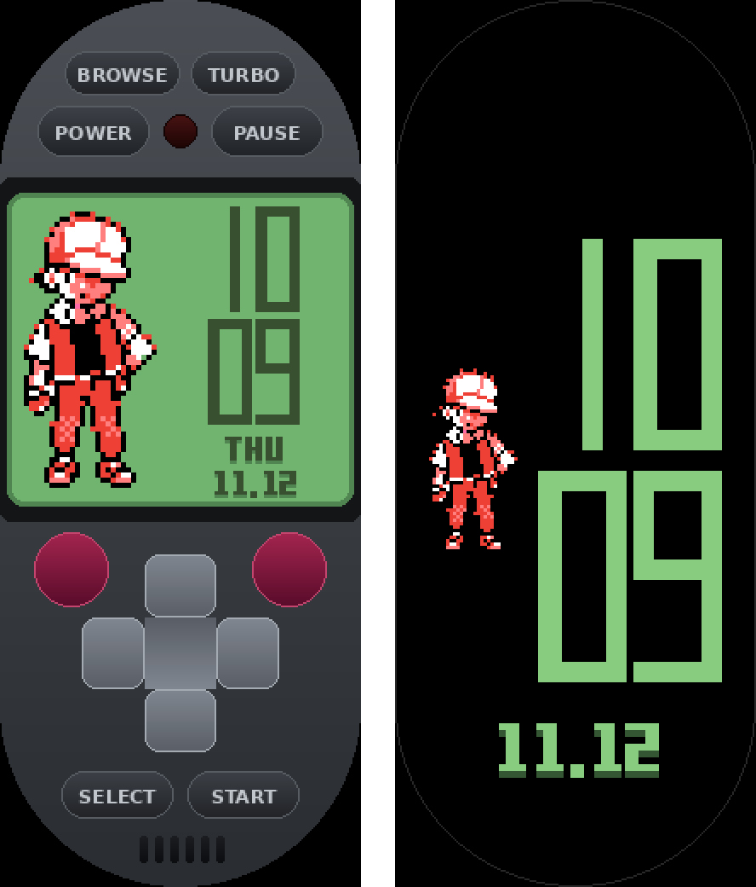
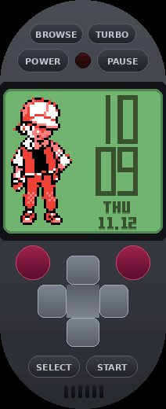

# RedBand GB 4.6.0: Pokémon Red on the Xiaomi Smart Band 10





## Which file to install

| File | What it is |
|---|---|
| `output/RedBand_GB_4_6_0.bin` | Watchface with the game and the Poketch always-on display (AOD) |
| `output/RedBand_GB_4_6_0_noAOD.bin` | The same without the AOD (use it if the band refuses the first) |
| `output/RedBand_GB_4_6_0_noROM.bin` / `_noROM_noAOD.bin` | No game ROM inside: for publishing (see `PUBLISHING.md`) |

The watchface ID is the same as in earlier builds, so a new install replaces the old one.

## Controls

| Control | Does |
|---|---|
| POWER | Start / stop the game. While stopped, the Poketch clock (time, weekday, date) shows. |
| PAUSE | Pause / play. |
| TURBO | Fast-forward (up to 4x). |
| BROWSE (game off) | Save files on the band: DELETE takes two taps ("SURE?"). |
| UNSAFE (game on) | FAST mode on/off (see below). The button looks pressed while FAST is on. |
| D-pad (centre), B (top-left), A (top-right), SELECT, START | Game buttons. All of them stay at least 20 px from the band's edges, so side swipes don't start band gestures. |
| Long-press the screen | View: BIG (crisp, full width), SMOOTH (GPU-scaled), FAST (1:1). |
| Tap the LED | Live figures: game fps, busy share, Lua memory, free memory, engine, ROM banks, map. |
| Long-press the LED | Display path: memory or files (only if the game screen stays black). |

## SAFE and FAST

Every POWER starts in **SAFE**. This build played to Viridian City without a crash:
- **Engine size:** the largest engine only with at least 6 MB free.
- **Memory:** the heap grows at most 1.5 MB, and 4 MB always stays free for the band.
- **CPU:** the game loop never keeps the CPU busy more than 80% of the time.

Tap **UNSAFE** while playing for **FAST**, the feel of 4.4.0 / 4.5.0:
- **Engine size:** the largest engine from 3 MB free, more ROM banks cached.
- **Memory:** the heap may grow 2.5 MB.
- **CPU:** the game may use 85% of the CPU time.

Switching hands the running game to another engine size through a save state, so nothing is
lost. It was tested to give exactly the same game. FAST keeps every safety net, and switches back
to SAFE by itself (with a message) the moment the band gets short of memory. Tap UNSAFE again to
go back to SAFE yourself.

## Saves

The save file is written only when you save in the game (START, SAVE), about 1 s after the game
finishes saving; nothing is saved on its own. It is written to a temporary file, checked, then
swapped in, and the previous save is kept as `.bak`. If anything goes wrong, the backup is used.
After saving, wait about 2 s before leaving the watchface.

## If it ever crashes

Open the watchface and press POWER: for 8 s the screen shows `last run: ...` with the figures from
just before the crash. That line says whether it was memory or the CPU.

## More

- `REPORT.md`: the engineering report (firmware findings, architecture, measurements, tests, all
  sources).
- `PUBLISHING.md`: text, files and credits for publishing.
- `LOCAL_VERIFICATION.txt`: test results.
- `FIRMWARE_FINDINGS.md`: firmware evidence.
- `THIRD_PARTY.md`: credits and licences.

## Rebuild and test

```
sh tests/build_hosts.sh
cd tools && python3 build_cores.py && python3 build_assets.py && python3 build_main.py && python3 split_rom.py && cd ..
python3 RedBandLuaWatchface/build_face.py            # with the ROM (personal use)
python3 RedBandLuaWatchface/build_face.py norom      # without the ROM (publishing)
sh tests/run_all.sh /path/to/gb-test-roms
```

Preview and GIFs: `tests/layout_dump.lua` (under `tests/bandhost64`), then
`tools/render_preview.py`, `tools/render_aod_preview.py`, `tools/gif_capture.lua` and
`tools/make_gif.py`.
